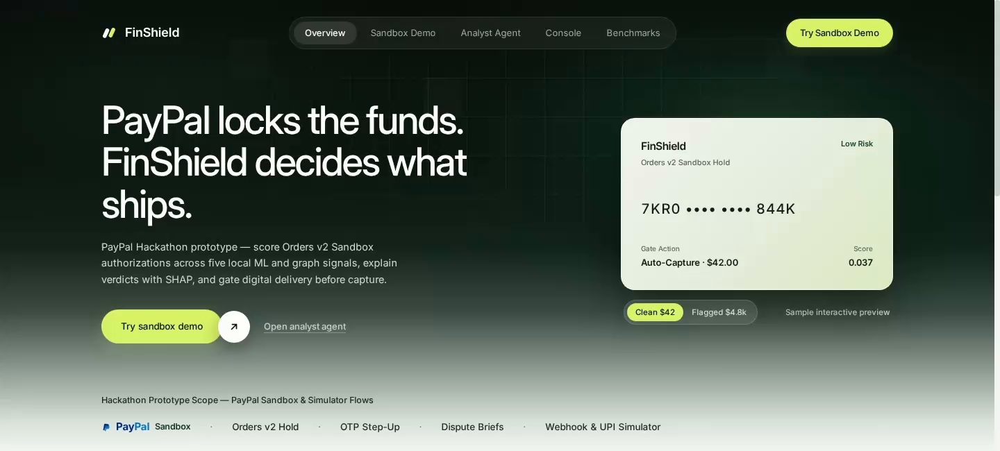
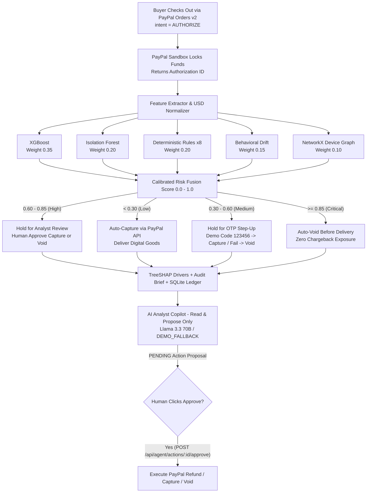

<div align="center">


# FinShield

**PayPal locks the funds. FinShield decides what ships.**

Post-authorization fulfilment security & fraud investigation platform for digital commerce — scoring PayPal Orders v2 authorization holds across **five independent ML, rule, and graph signals**, explaining verdicts with **TreeSHAP**, and gating capture, OTP step-up, review, or pre-delivery void behind a **human-approved AI analyst agent**.

[](#how-paypal-and-ai-work-together)
[](#offline-ulb-benchmarks)
[](#api-surface)
[](#repository-structure)
[](#testing--verification)
[](LICENSE)

<br />



</div>

---

## Why FinShield?

Digital goods merchants face an asymmetric timing problem: **stolen cards, card-testing rings, and friendly fraudsters pass checkout**, download licenses, credits, or API keys instantly, and trigger chargebacks weeks later.

Pre-checkout risk filters cause costly false declines, while post-capture checks happen *after* digital goods have already shipped. With **PayPal Orders v2 (`intent=AUTHORIZE`)**, FinShield intervenes at the exact right millisecond: **after the buyer authorizes funds, and before fulfilment unlocks.**

---

## What Was Built for the PayPal AI Hackathon

This repository combines our existing offline ML fraud research core (`src/finsheild/`, tagged `pre-paypal` on `main`) with a full-stack **PayPal Sandbox & AI Analyst integration** built on the `paypal-hackathon` branch:

- **Pre-existing core (`pre-paypal`):** 5-signal ML fraud engine trained on the ULB dataset (`XGBoost`, `IsolationForest`, behavioral profiling, 8 deterministic rules, `NetworkX` entity graph, `TreeSHAP` explainability) and earlier console views.
- **Built during this hackathon:**
  - `backend/paypal/` — PayPal OAuth REST client with thread-safe token caching, `PayPal-Request-Id` idempotency keys, `PayPal-Debug-Id` diagnostics, webhook ingestion/deduplication, and an in-memory stub transport (`PAYPAL_ENV=stub`).
  - **Pre-Delivery Authorization Gate** — PayPal Orders v2 (`intent=AUTHORIZE`) + PayPal JS SDK v6 & redirect approval flows routing holds through `Auto-Capture`, `OTP Step-Up`, `Analyst Review`, and `Auto-Void`, with currency-normalized USD scoring.
  - `backend/agent/` — Tool-calling Analyst Agent (`llama-3.3-70b-versatile` via Groq / OpenAI-compatible API + deterministic fallback) that investigates transactions, runs dispute simulations, drafts audit evidence briefs, and queues **human-approved** captures, voids, and refunds.
  - `frontend/` — Redesigned Next.js 16 dark-emerald workstation with `/paypal` live Sandbox studio, `/agent` copilot queue, `/investigate` SHAP + device ring forensics, and `/performance` ULB benchmarks, plus `backend/tests/test_paypal_flow.py`.

---

## How PayPal and AI Work Together



### PayPal Developer Platform Integration
- **PayPal Orders v2 & Payments v2 REST APIs (`backend/paypal/client.py`):** Authenticates via OAuth 2.0, creates `AUTHORIZE` orders, authorizes holds, captures clean/OTP-verified payments, voids fraudulent holds cleanly (handling PayPal `204 No Content`), and issues idempotent refunds.
- **PayPal JS SDK v6 + Redirect Approval (`frontend/components/paypal.tsx`):** Drives live Sandbox checkout with automatic fallback to Orders v2 `approve_url` redirect flows.
- **Webhooks & Dispute Simulation (`backend/paypal/router.py`):** Ingests asynchronous PayPal events with idempotent deduplication and builds **Dispute Evidence Briefs** packaging pre-delivery risk score, timing, and SHAP attributions.

### AI & ML Guardrail Design
1. **Calibrated Hybrid Risk Engine:** Fuses supervised classification (`XGBoost`, 500 trees), unsupervised outlier detection (`IsolationForest`, trained strictly on legitimate orders), personal behavioral baselines, 8 hard policy rules, and `NetworkX` shared-device cliques.
2. **Mathematical Explainability (`TreeSHAP`):** Explains every hold (`amount_deviation`, `velocity_5m`, shared hardware cluster, geographic jump) instead of returning opaque scores.
3. **Human-in-the-Loop Tool Boundary (`backend/agent/tools.py`):** The LLM copilot uses read tools (`list_high_risk_transactions`, `get_transaction_risk`) and proposal tools (`propose_capture`, `propose_void`, `propose_refund`) that **only write `PENDING` rows**. Automated tests in `backend/tests/test_agent_guardrail.py` verify that no money-moving PayPal call is reachable from the AI agent loop without explicit human click approval.

---

## Pre-Delivery Fulfilment Scenarios (`/paypal`)

| Scenario | Order Value | Triggered Signals | Gate Action |
| :--- | :---: | :--- | :--- |
| **Clean Returning Buyer** | `$42.00` | Known device, habitual spend, zero tripwires | `AUTO_CAPTURE` (delivers cleanly) |
| **Friendly-Fraudster** | `$220.00` | `4.8×` spend spike over typical baseline | `HOLD_STEP_UP` (`123456` OTP captures; wrong code voids) |
| **Suspicious Pattern** | `$180.00` | New device + transaction velocity spike | `HOLD_FOR_REVIEW` (analyst approve / void queue) |
| **Stolen Account / Card Ring** | `$4,800.00` | Shared hardware `DEV-NEW-PAYPAL`, `8` rapid attempts, `400 km` jump | `AUTO_VOID` (released before delivery) |

---

## Offline ULB Benchmarks

Evaluated offline on the **Kaggle ULB Credit Card Fraud Dataset** (`284,807` transactions, `492` fraud cases / `0.17%` positive class) using zero-leakage stratified splits (`70% / 15% / 15%`) with `StandardScaler` fitted exclusively on the training partition:

| Model | ROC-AUC | PR-AUC | Precision `@0.5` | Recall `@0.5` | F1 Score |
| :--- | :---: | :---: | :---: | :---: | :---: |
| Logistic Regression *(Baseline)* | `0.9495` | `0.7005` | `0.8197` | `0.6757` | `0.7407` |
| **XGBoost (500 Trees, Scaled)** | **`0.9709`** | **`0.8418`** | **`0.9206`** | **`0.7838`** | **`0.8467`** |

*Held-out test confusion matrix (`42,722` transactions): `58` True Positives · `5` False Positives · `16` False Negatives · `42,643` True Negatives.*

---

## Quickstart (Run Locally in 60 Seconds)

### Option 1 — Zero-Credential Local Mode (`PAYPAL_ENV=stub`)
Run the entire PayPal authorization -> risk gate -> AI analyst agent workflow offline using FinShield's deterministic in-memory PayPal transport and `DEMO_FALLBACK` investigator:

```bash
git clone -b paypal-hackathon https://github.com/riddhibantia/finshield.git
cd finshield

# 1. Python environment
python3 -m venv .venv
source .venv/bin/activate
pip install -r requirements.txt

# 2. Configure env (stub mode works with no external secrets)
cp .env.example .env
# Set PAYPAL_ENV=stub inside .env

# 3. Launch FastAPI (:8000) + Next.js (:5173)
bash start_app.sh
```

Open **[http://127.0.0.1:5173/paypal](http://127.0.0.1:5173/paypal)** for the Sandbox Studio, **[http://127.0.0.1:5173/agent](http://127.0.0.1:5173/agent)** for the Analyst Copilot, and **[http://127.0.0.1:8000/docs](http://127.0.0.1:8000/docs)** for Swagger API docs.

### Option 2 — Live PayPal Developer Sandbox + Groq LLM
1. Create a free REST app in the [PayPal Developer Dashboard](https://developer.paypal.com/dashboard/applications/sandbox) and copy its **Client ID** and **Secret**.
2. Populate `.env`:
   ```env
   PAYPAL_ENV=sandbox
   PAYPAL_CLIENT_ID=your_sandbox_client_id
   PAYPAL_CLIENT_SECRET=your_sandbox_client_secret
   LLM_BASE_URL=https://api.groq.com/openai/v1
   LLM_API_KEY=your_optional_groq_api_key
   LLM_MODEL=llama-3.3-70b-versatile
   ```
3. Run `bash start_app.sh` and test real Sandbox checkouts using a PayPal Sandbox personal buyer account (`OTP` verification code for the `$220` scenario is `123456`).

---

## Deployment

### Backend (`Render`)
A ready-to-use Blueprint lives in [`render.yaml`](render.yaml):
- **Build:** `pip install -r requirements-api.txt`
- **Start:** `uvicorn backend.main:app --host 0.0.0.0 --port $PORT`
- **Health Check:** `/api/health`
- Configure `PAYPAL_ENV=sandbox`, `PAYPAL_CLIENT_ID`, `PAYPAL_CLIENT_SECRET`, `FINSHEILD_CORS_ORIGINS`, and optional `LLM_*` secrets in Render.

### Frontend (`Vercel`)
Deploy `frontend/` on Vercel with `NEXT_PUBLIC_API_URL` (or backend rewrite) pointing to your deployed FastAPI URL.

---

## Testing & Verification

```bash
# Backend + PayPal flow + Agent guardrail suite (36 tests)
PYTHONPATH=.:src pytest backend/tests/ -q

# Full ML + Backend test suite
PYTHONPATH=.:src pytest -q

# Frontend TypeScript check & production build
cd frontend && npx tsc --noEmit && npm run build
```

---

## API Surface

| Surface | Prefix | Endpoints | Highlights |
| :--- | :--- | :---: | :--- |
| **PayPal Pre-Delivery Gate** | `/api/paypal/*` | `16` | Order create, `AUTHORIZE`, capture, void (`204`), OTP verify, human approve, disputes, webhooks |
| **Guarded Analyst Agent** | `/api/agent/*` | `5` | OpenAI-compatible tool-calling chat, pending action list, human `approve` / `reject` |
| **Risk Engine & Forensics** | `/api/*` | `13` | Transaction scoring, SHAP explain, NetworkX graph, identity baseline, ULB metrics |

---

## Repository Structure

```text
finshield/
├── backend/
│   ├── main.py              # FastAPI app + ML core, SHAP, graph & legacy endpoints
│   ├── paypal/              # Orders v2 client, mapper, SQLite store, stub & router
│   ├── agent/               # Tool-calling analyst loop + human-approval router
│   ├── adapters/            # Real ML adapter + fallback scoring adapter
│   └── tests/               # PayPal flow, client & agent guardrail tests
├── frontend/
│   ├── app/                 # Overview (/), /paypal, /agent, /investigate, /command-center, /performance
│   ├── components/          # FinShield chrome, BrandMark, PayPal checkout studio
│   └── public/favicon.svg   # FinShield double-slash mark
├── src/finsheild/           # Offline training, features, rules, NetworkX graph & SHAP core
├── models/xgboost/          # Tracked ULB XGBoost model, scaler, thresholds & columns
├── evaluation/              # Tracked ULB benchmark metrics & markdown reports
├── docs/                    # Architecture decisions, dataset notes & hero asset
├── render.yaml              # Render deployment blueprint (FastAPI API service)
└── start_app.sh             # One-command local dev launcher (:8000 + :5173)
```

---

## Author & License

Built by **Riddhi Bantia** & contributors. Licensed under the [MIT License](LICENSE).
